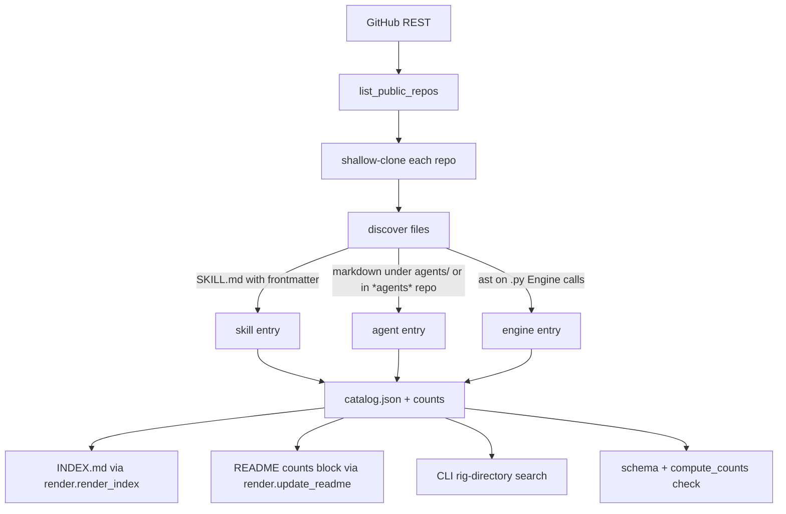
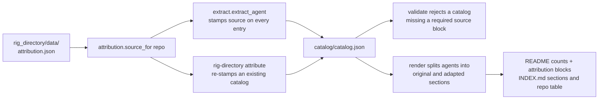

# Architecture

This document explains how `rig-agent-directory` is built. Every claim
references the source so a reader can verify it on a fresh checkout.

## What the system does

The repository crawls the public repos of a GitHub owner (default
`mrodgersjs-web`), pulls out three kinds of catalog entries
(skills, agents, deviation engines) by reading files (it never
imports code), and stores the result as a single typed JSON document.
That document is the only source of truth for `INDEX.md`, the README
counts block, and the search CLI.



## Three layers

1. **Ingestion** — `rig_directory/crawl.py` lists public repos via the
   GitHub REST API and shallow-clones each (or reads pre-cloned
   fixtures for offline use). No forks are crawled; private repos
   are skipped.
2. **Extraction** — `rig_directory/extract.py` reads files. Skills
   come from `SKILL.md` frontmatter; agents come from
   `*.md` frontmatter under `agents/` or in any repo whose name
   contains `agents`; deviation engines come from `ast`-parsed
   `Engine(id, codename, layer, ...)` calls in Python files.
3. **Catalog** — `rig_directory/catalog.py` assembles the typed JSON
   document, validates it against `rig_directory/schema/catalog.schema.json`,
   recomputes counts via `compute_counts`, and exposes `search` /
   `validate` / `entries`. The CLI in `rig_directory/cli.py` adds the
   `crawl`, `validate`, `search`, `index`, `readme`, and `stats`
   commands.

## Counts and drift

The catalog has one `counts` block at the top:

| key | meaning |
|---|---|
| `repos` | Public repos listed by the GitHub API |
| `repos_crawled` | Repos that had a local checkout and were read |
| `skills` | Skill entries (a single skill can appear in several packs) |
| `skills_unique_names` | Distinct skill names across packs |
| `agents` | Agent entries |
| `agents_unique_names` | Distinct agent names |
| `agents_attributed` | Agent entries carrying an upstream `source` block (adapted, not original) |
| `agents_original` | Agent entries with no `source` block (original to the catalog owner) |
| `engines` | Deviation engines |

`compute_counts(catalog)` rebuilds these from the entry lists; the
schema validator (`validate`) refuses any catalog where
`catalog["counts"] != compute_counts(catalog)`. That is the drift
detector — a hand edit that misses updating `counts` cannot pass
schema validation.

## Generated docs

Two deliverables are derived from the catalog and never typed by
hand (a third, the README attribution block, is described under
[Attribution](#attribution-is-a-data-record-not-prose) below):

- `INDEX.md` is the rendered table of every entry with its
  description, repo, and kind. `tests/test_directory.py`
  (`test_index_lists_every_entry_and_escapes_pipes`) checks that
  every entry appears in the rendered file and that pipe characters
  in descriptions are escaped.
- The README counts block sits between
  `<!-- counts:start (generated by rig-directory readme; do not edit by hand) -->`
  and `<!-- counts:end -->` and is regenerated by
  `rig-directory readme --check` (which exits 0 only if the block is
  in sync).
- The README attribution block sits between
  `<!-- attribution:start ... -->` and `<!-- attribution:end -->` and
  is regenerated in the same pass. `rig-directory readme` refuses to
  write when the catalog carries attributed entries and the README has
  no attribution markers, so the statement cannot be deleted and left
  stale.

CI runs both checks on every push and PR; a stale block fails the
build.

## Attribution is a data record, not prose

Some repos in this catalog are not original work by the catalog
owner. Those facts live in
`rig_directory/data/attribution.json`, one record per adapted repo:

| field | meaning |
|---|---|
| `repo` | the repo in this catalog whose entries are adapted |
| `origin` | `adapted` (the only supported value today) |
| `upstream_owner`, `upstream_repo`, `upstream_url` | who wrote the original and where |
| `license`, `license_url` | the license the upstream work ships under |
| `note` | one plain-English sentence, used verbatim in the rendered docs |
| `evidence` | how and when the adaptation was measured |

The current record covers `rig-domain-agents`, adapted from
[`msitarzewski/agency-agents`](https://github.com/msitarzewski/agency-agents)
under the MIT license. An audit on 2026-10-19 byte-compared the
repo's git blobs against upstream and found 161 of 260 blobs
identical; the upstream repo's LICENSE restores its copyright and its
README carries an attribution note at commit `1697f62`.

The record reaches every surface by three steps, and no hand
editing in between:



- **Extraction** stamps the block at crawl time, so a fresh crawl
  cannot present adapted work as original.
- **Validation** rejects two failure modes: an entry from an
  attributed repo with no `source` block, and an entry from a repo
  that is *not* on the list claiming one. The counts split
  (`agents_attributed` / `agents_original`) is recomputed from the
  stamped entries, so editing a count alone also fails.
- **Rendering** derives the README and `INDEX.md` text from the
  stamped entries: two separate agent sections, an Origin column in
  the repo table, and the attribution paragraph. There is no prose to
  keep in sync by hand.

`tests/test_attribution.py` covers all three layers, including a
planted failure per direction (drop a `source` block, and claim one
on a repo that has no upstream).

To add another adapted repo: append one record to
`rig_directory/data/attribution.json`, then run
`rig-directory crawl` (or `rig-directory attribute` on an existing
catalog), `rig-directory readme`, and `rig-directory index`.

## What is and is not crawled

| source | included |
|---|---|
| Public repo on `mrodgersjs-web` | yes, listed |
| Public repo with a `SKILL.md` | skills extracted |
| Public repo with `agents/` or whose name contains `agents` | agents extracted |
| Public repo with `*.py` files that import `Engine(...)` | engines extracted |
| Fork | listed but not crawled |
| Private repo | skipped entirely |
| Local-only repo (no GitHub presence) | outside the catalog's scope |

This list is also the short answer to "why does the count look low?"
— the skills library is private, so its dozens of skills never
appear.

## When the public catalog is wrong

The catalog is regenerated weekly by `.github/workflows/refresh.yml`
on Sunday and uploaded as a workflow artifact (no automatic merge).
To force a refresh locally:

```bash
rig-directory crawl --live --checkouts .cache/repos
rig-directory validate
rig-directory index
rig-directory readme
```

Read the diff, commit the three changed files together, and push.

## Extension points

- **A new kind** (for example `prompt` or `recipe`) means a new
  extractor in `rig_directory/extract.py`, an entry shape in
  `rig_directory/schema/catalog.schema.json`, and a row in
  `catalog["counts"]` plus a line in `compute_counts`.
- **A new extractor** for a different file format should keep the
  shape of the entries it returns: `name`, `description`, `repo`,
  plus whatever kind-specific fields the schema allows.
- **A new CLI subcommand** belongs in `rig_directory/cli.py`. Wire
  it to a `cmd_<verb>(args)` function, register it in `main`,
  and add an end-to-end test in `tests/test_cli.py`.

## Performance budget

The fixture catalog (28 repos, 6 fixtures × small file counts) builds
in well under a second. A real weekly refresh over 29 public repos
takes a couple of minutes including clone time; the catalog build
itself is dominated by file reads and YAML parsing.
